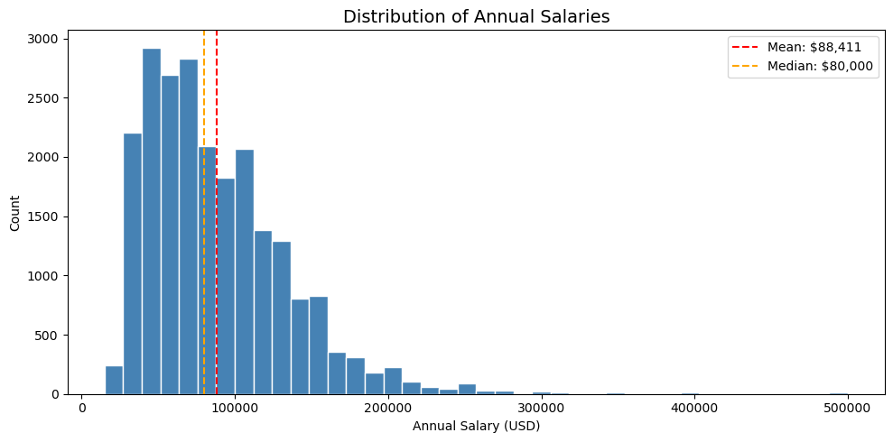
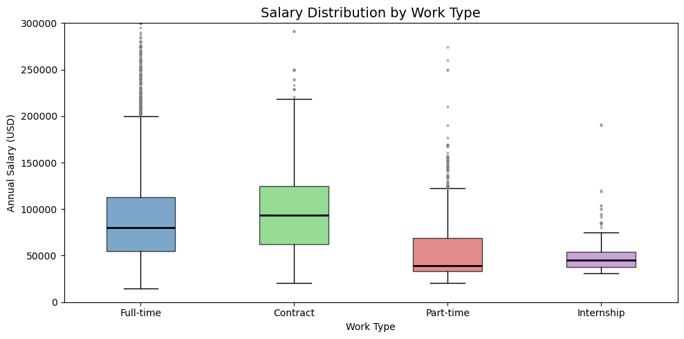
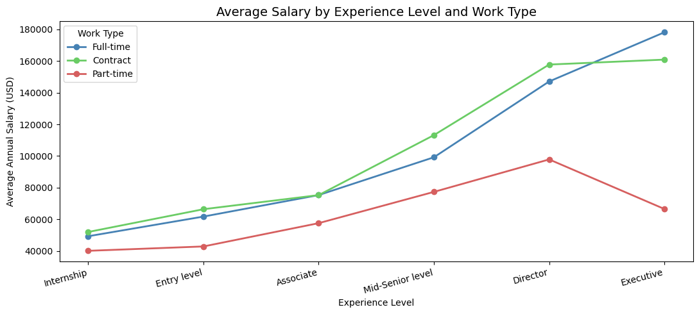

# Job Salary Analysis

An individual data analysis project for **Programming for Data Analysis (CA1)** at Singapore Polytechnic. It explores how experience, work type and location affect salary in job postings.

## Key findings

### Salaries are right-skewed
The mean annual salary ($88,411) is higher than the median ($80,000), because a few very high salaries pull the average up.

### Work type matters
Contract roles have the highest median salary, and internships the lowest. Full-time roles have many high outliers.

### Pay rises with seniority, except part-time
Average salary climbs with experience level for full-time and contract work. Part-time pay drops at the Executive level, while full-time keeps rising.

## What I did
- Merged five job-posting files (CSV and Excel) into one dataset
- Removed junk columns and checked that no job listings were lost in the merges
- Converted hourly, weekly, monthly and biweekly pay into **annual salaries** so comparisons were fair
- Removed nulls and outliers, then visualised the results with five chart types

## Tools
Python · pandas · matplotlib · Jupyter Notebook

## Data
The job-posting files are not included. <!-- EDIT: say where they came from, e.g. provided by the school or a public source -->

## How to run
1. `pip install pandas matplotlib openpyxl jupyter`
2. Put the data files next to `CA1.ipynb` and update the file paths in the first cells
3. Run all cells

## Presentation
Slides are on my portfolio website: <!-- EDIT: paste your site link -->
